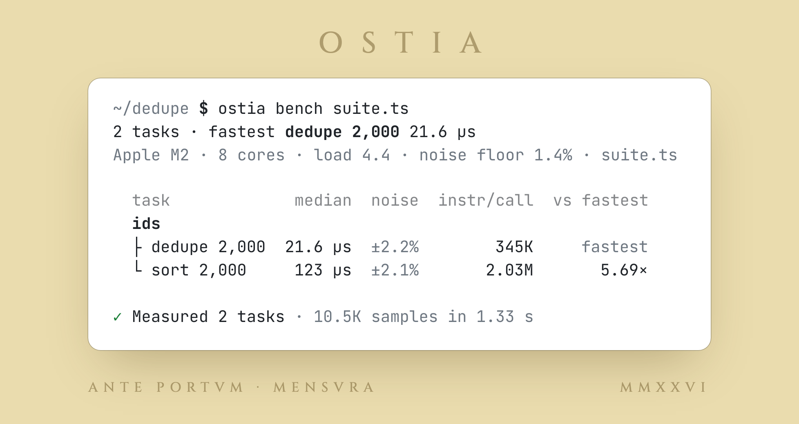
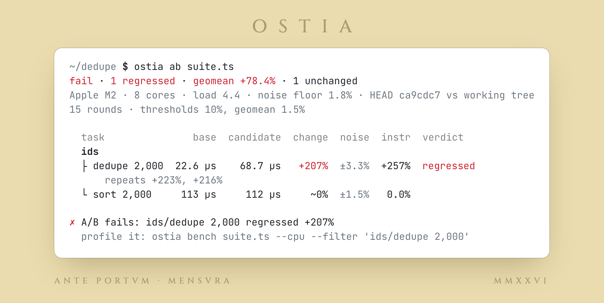
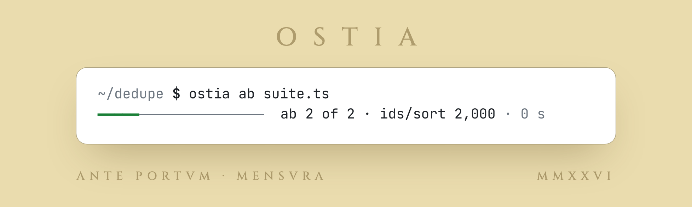
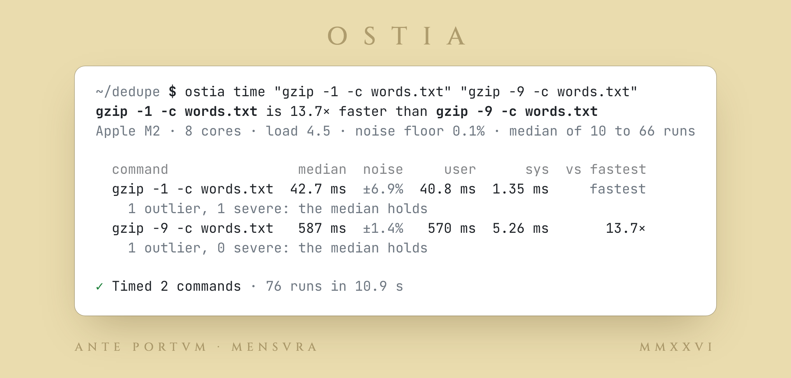

# ostia

Fast profiling and benchmarking for Bun.

ostia times commands and functions on Bun,
then tells you whether a change made them slower:
it compares two runs with statistics that account for how noisy your
machine is, and `ostia ab` confirms a regression in fresh processes
before it reports one.
The CLI and the library do the same things,
and every result is one JSON document.

```ts
// suite.ts
import { group, task } from "ostia"
import { dedupe } from "./dedupe.ts"

const ids = Array.from({ length: 2_000 }, (_, i) => (i * 7919) % 500)

group("ids", () => {
  task("dedupe 2,000", () => dedupe(ids))
  task("sort 2,000", () => ids.toSorted((a, b) => a - b))
})
```

<picture>
  <source media="(prefers-color-scheme: dark)" srcset="https://raw.githubusercontent.com/metonym/ostia/master/.github/assets/bench-dark.png">
  
</picture>

**It tells you when a change made something slower.**
Rewrite `dedupe` from a `Set` to `indexOf`,
and `ostia ab` runs your suite against `HEAD` and the working tree in
alternating batches in one process:

<picture>
  <source media="(prefers-color-scheme: dark)" srcset="https://raw.githubusercontent.com/metonym/ostia/master/.github/assets/ab-dark.png">
  
</picture>

While it runs, one line says where it is:

<picture>
  <source media="(prefers-color-scheme: dark)" srcset="https://raw.githubusercontent.com/metonym/ostia/master/.github/assets/progress-dark.png">
  
</picture>

Exit 1 on a regression, so CI can gate on it.
`ostia time` does the same for whole commands:

<picture>
  <source media="(prefers-color-scheme: dark)" srcset="https://raw.githubusercontent.com/metonym/ostia/master/.github/assets/time-dark.png">
  
</picture>
ostia has no dependencies and needs Bun ≥ 1.4.

## Quick start

```sh
bun add -d ostia
```

Write a suite with `group()` and `task()`, as above, then:

```sh
ostia bench suite.ts      # time each task
ostia ab suite.ts         # compare the working tree with HEAD
```

Exit status: 0 pass, 1 a regression (`ab`, `compare`, `ci`), 2 an error.

## Common tasks

```sh
# Time two commands against each other
ostia time "bun a.ts" "bun b.ts"

# Compare two saved runs
ostia compare before.json after.json

# Save a baseline on known-good code, then gate CI on it
ostia baseline save
ostia ci

# Capture a CPU profile while timing
ostia time "bun a.ts" --cpu

# One JSON object per line, for a script or an agent
ostia bench suite.ts --format events
```

These docs ship in the package, at `node_modules/ostia/docs/`.

## From code

```ts
const doc = await time({
  commands: ["bun a.ts", { command: "bun b.ts", label: "b", prepare: "rm -rf dist" }],
  samples: 20,
  cpu: true,
})

group("parse", () => {
  sweep({ size: range(100, 10_000) }, ({ size }) => {
    const input = buildInput(size) // unmeasured setup, once per point
    task("parse", () => parse(input), { isolate: true })
  })
})

const result = compareDocuments(await loadDocument("before.json"), doc)
if (result.summary.verdict === "fail") process.exitCode = 1

const { text } = await renderers.markdown.render(doc, {})
```

## Docs

- [CLI](https://github.com/metonym/ostia/blob/master/docs/cli.md): every
  command and flag
- [Library](https://github.com/metonym/ostia/blob/master/docs/library.md):
  `time()`, `bench()`, `ab()`, `profile()`, and documents
- [Config](https://github.com/metonym/ostia/blob/master/docs/config.md):
  `ostia.config` workloads, thresholds and baselines
- [Machine-readable output](https://github.com/metonym/ostia/blob/master/docs/agent-protocol.md):
  `--format events`, exit codes and error codes, for scripts and agents
- [Statistics](https://github.com/metonym/ostia/blob/master/docs/statistics.md):
  how a comparison decides, and the noise floor
- [Document schema](https://github.com/metonym/ostia/blob/master/docs/document-schema.md):
  the JSON a run writes
- [Preload recipes](https://github.com/metonym/ostia/blob/master/docs/preload-recipes.md):
  DOM, Svelte and other setups a suite needs
